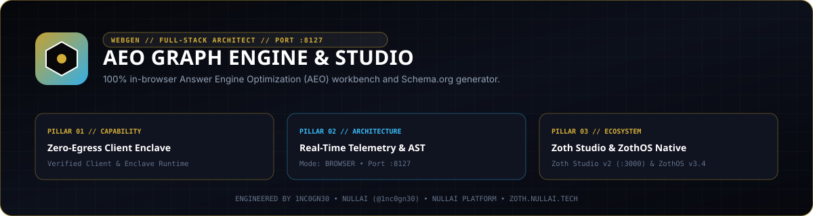

# AEO Graph Engine



Zero-dependency Answer Engine Optimization (AEO/GEO) toolkit, Schema.org JSON-LD `@graph` compiler, `llms.txt` and `ai.txt` manifest generator, AI crawler directive auditor, claim-evidence quotability analyzer, and Model Context Protocol (MCP) server.

- **Local Workstation**: `http://127.0.0.1:8127`
- **Zoth Studio v2 Dossier**: [https://zoth.nullai.tech/tools/aeo-graph-engine](https://zoth.nullai.tech/tools/aeo-graph-engine)
- **Repository**: [https://github.com/1nc0gn30/aeo-graph-engine](https://github.com/1nc0gn30/aeo-graph-engine)

## Overview

AEO Graph Engine runs on Python 3.9+ using only the standard library (`json`, `urllib`, `html.parser`, `xml.etree.ElementTree`, `http.server`) alongside a standalone in-browser Studio UI. It compiles linked Schema.org entity graphs, machine-readable LLM context files, and crawler access policies for AI search and citation systems (GPTBot, OAI-SearchBot, ClaudeBot, PerplexityBot, Google-Extended, Applebot-Extended).

Core capabilities:
- **Linked Schema.org `@graph` Compiler**: Emits cross-referenced `@id` graphs (`Organization`, `WebSite`, `WebApplication` / `SoftwareApplication`, `FAQPage`, `BreadcrumbList`, `TechArticle`, `ClaimReview`) with deterministic JSON-LD validation.
- **Machine Context Manifests**: Generates `llms.txt`, `llms-full.txt`, `ai.txt`, and RFC 9309 `robots.txt` policies from project metadata, live URLs, or natural-language prompts.
- **Live Multi-Page Crawler & Bot Shield**: Audits live domains, sitemaps, structured data coverage, canonical headers, and per-bot crawler directives with competitor delta benchmarking.
- **Claim-Evidence & Citation Simulator**: Extracts factual claims, scores empirical quotability, generates W3C `#:~:text=` scroll-to-text fragment anchors, and simulates RAG citation retrieval.
- **Multi-Framework Code Exporter**: Outputs drop-in structured data components for Next.js (App and Pages Router), Astro, Vite + React, SvelteKit, Remix, Nuxt 3, and Hugo/Jekyll.

## Architecture

```text
aeo-graph-engine/
├── server.py                              # Standalone loopback workstation entrypoint (127.0.0.1:8127)
├── bin/
│   ├── aeo-graph.js                       # Unified CLI, Web UI, and Electron desktop launcher
│   └── aeo-graph-engine-tui               # Terminal dashboard launcher
├── public/                                # Zero-egress browser AEO Studio UI
├── docs/                                  # Architecture, MCP, AI agent, and platform guides
├── src/aeo_graph_engine/
│   ├── core.py                            # Schema.org @graph, llms.txt, ai.txt & robots.txt compiler
│   ├── validator.py & injector.py         # Bundle validator and idempotent HTML <head> injector
│   ├── scanner.py & crawler.py            # Live HTTP/HTML scanner and multi-page sitemap crawler
│   ├── bot_inspector.py                   # AI crawler User-Agent registry and robots.txt evaluator
│   ├── knowledge_graph.py                 # Subject-predicate-object triplet & entity extractor
│   ├── claim_evidence_matrix.py           # Claim-evidence scoring, ClaimReview & text-fragment builder
│   ├── citation_simulator.py              # Answer engine retrieval & citation readiness simulator
│   ├── framework_exporter.py              # Next.js, Astro, SvelteKit, Nuxt, Remix, React exporters
│   ├── ci_gate.py                         # CI/CD readiness score gate (text, JSON, GitHub annotations)
│   ├── mcp_server.py                      # JSON-RPC 2.0 stdio MCP server (12 tools)
│   ├── ui_server.py                       # Threading HTTP REST API & Studio server (:8127)
│   └── cli.py                             # aeo CLI router
└── tests/                                 # 237-test pytest verification suite
```

## Quickstart

```bash
git clone https://github.com/1nc0gn30/aeo-graph-engine.git
cd aeo-graph-engine
pip install -e .

# Launch the local AEO Studio UI and REST API on 127.0.0.1:8127
python3 server.py --port 8127
```

Open `http://127.0.0.1:8127` in your browser, or serve the static client workstation directly:

```bash
python3 -m http.server 8127 --directory public
```

## CLI & MCP Usage

Installing via `pip install -e .` registers the `aeo` CLI binary (and ZothOS v3.4.0 exposes `aeo` and `aeo-graph` on `$PATH`).

```bash
# Check status, platform info, and JSON telemetry
aeo --help
aeo --json
aeo --platform

# Generate a complete AEO bundle (schema.jsonld, llms.txt, llms-full.txt, ai.txt, robots.txt)
aeo --generate-all --site-name "NullAI" --domain "nullai.tech" --niche developer_tools --output-dir ./dist_aeo
aeo --validate ./dist_aeo

# Synthesize an AEO bundle from a natural-language project description
aeo prompt "Open-source Rust vector database on vectordb.dev" --output-dir ./dist_prompt

# Scan a live URL or local directory and run the CI quality gate
aeo scan https://example.com --format json
aeo check . --min-score 80 --fail-on-missing-llms
aeo bot-audit https://example.com

# Extract knowledge graph triplets, claim-evidence matrix, and citation simulation
aeo knowledge-graph ./public/index.html --format json
aeo claims ./public/index.html --format json
aeo simulate https://example.com --query "What is example.com?"

# Export framework-native components (nextjs_app, nextjs_pages, astro, vite_react, sveltekit, remix, nuxt3, hugo)
aeo framework nextjs_app --output-dir ./aeo_nextjs

# Launch the interactive Studio server on 127.0.0.1:8127
aeo serve --host 127.0.0.1 --port 8127
```

### MCP Server Integration

Start the JSON-RPC 2.0 `stdio` MCP server or export client configurations for Claude Desktop, Cursor, Cline, or Zed:

```bash
aeo mcp
aeo mcp --config claude_desktop
aeo mcp --config cursor
```

Registered MCP tools (12):
- `aeo_scan_site` — Audit a URL or local path for Schema.org, `llms.txt`, and crawler readiness.
- `aeo_synthesize_prompt` — Synthesize a complete AEO configuration from a text description.
- `aeo_generate_bundle` — Compile JSON-LD `@graph`, `llms.txt`, `llms-full.txt`, `ai.txt`, and `robots.txt`.
- `aeo_inject_html` — Inject JSON-LD and discovery `<link>` tags into HTML `<head>`.
- `aeo_validate` — Validate JSON-LD graph integrity and `llms.txt` structure.
- `aeo_get_framework_snippets` — Export framework-specific structured data components.
- `aeo_simulate_citation` — Simulate LLM RAG retrieval and citation scoring for a query.
- `aeo_visualize_schema` — Build entity-relationship node/edge graphs from JSON-LD.
- `aeo_crawl_sitemap` — Crawl sitemaps and multi-page structured data graphs.
- `aeo_extract_knowledge_graph` — Extract subject-predicate-object triplets from HTML or Markdown.
- `aeo_analyze_claims` — Score factual claims and empirical evidence density.
- `aeo_generate_claim_matrix` — Emit `ClaimReview` JSON-LD and `#:~:text=` deep-link anchors.

## REST API Endpoints

Bound by default to `http://127.0.0.1:8127`:

| Method | Endpoint | Description |
| :--- | :--- | :--- |
| `GET` | `/health`, `/api/health`, `/api/status` | Service health and runtime configuration |
| `POST` | `/api/generate` | Compile Schema.org `@graph`, `llms.txt`, `ai.txt`, and `robots.txt` |
| `POST` | `/api/scan` | Audit a live URL or HTML document for AEO readiness |
| `POST` | `/api/validate` | Validate JSON-LD and AEO bundle artifacts |
| `POST` | `/api/inject` | Inject structured data and discovery tags into HTML |
| `POST` | `/api/bot-audit` | Evaluate `robots.txt` rules across frontier AI crawlers |
| `POST` | `/api/crawl-sitemap` | Crawl sitemap URLs and aggregate structured data coverage |
| `POST` | `/api/knowledge-graph` | Extract entity-relationship triplets from page content |
| `POST` | `/api/claims`, `/api/claim-matrix` | Analyze claims, quotability, and `ClaimReview` matrices |
| `POST` | `/api/simulate-citation` | Run deterministic RAG citation readiness simulation |
| `POST` | `/api/visualize-schema` | Return node/edge topology for Schema.org `@graph` payloads |
| `POST` | `/api/compare` | Benchmark AEO scores across multiple domains |
| `POST` | `/api/export-framework` | Generate Next.js, Astro, SvelteKit, Nuxt, or React snippets |
| `POST` | `/api/report`, `/api/export-zip` | Export Markdown/HTML audit reports or full ZIP bundles |
| `GET` | `/api/mcp/config` | Export MCP client configuration JSON |

## Testing & Verification

```bash
# Run the 237-test pytest suite
PYTHONPATH=src python3 -m pytest -q

# Run built-in CLI self-tests and CI quality gate
PYTHONPATH=src python3 -m aeo_graph_engine.cli --test
PYTHONPATH=src python3 -m aeo_graph_engine.cli check . --min-score 80 --fail-on-missing-llms

# Secret hygiene verification
gitleaks detect --source . --no-banner --redact
```

## Support

AEO Graph Engine is 100% free and open-source software with zero paywalls or feature gates. Optional support: [Buy Us a Coffee (Stripe)](https://buy.stripe.com/3cIfZg27PdKo2D64Ocfw40X).

## License

MIT License — Copyright (c) 1nc0gn30 ([https://1nc0gn30.si](https://1nc0gn30.si)) & NullAI ([https://nullai.tech](https://nullai.tech)).
